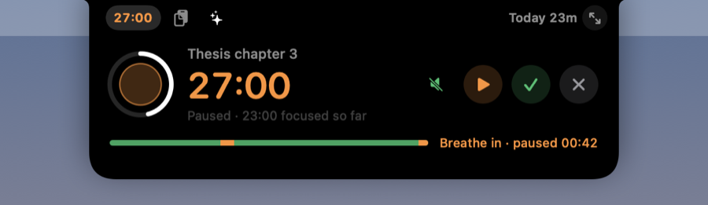
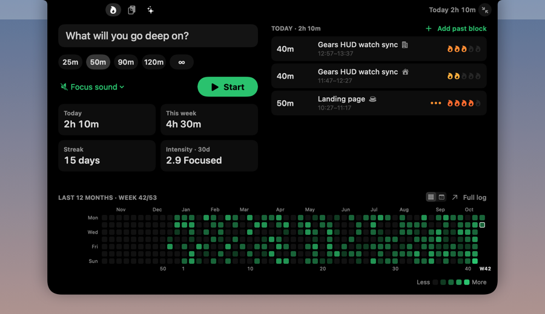
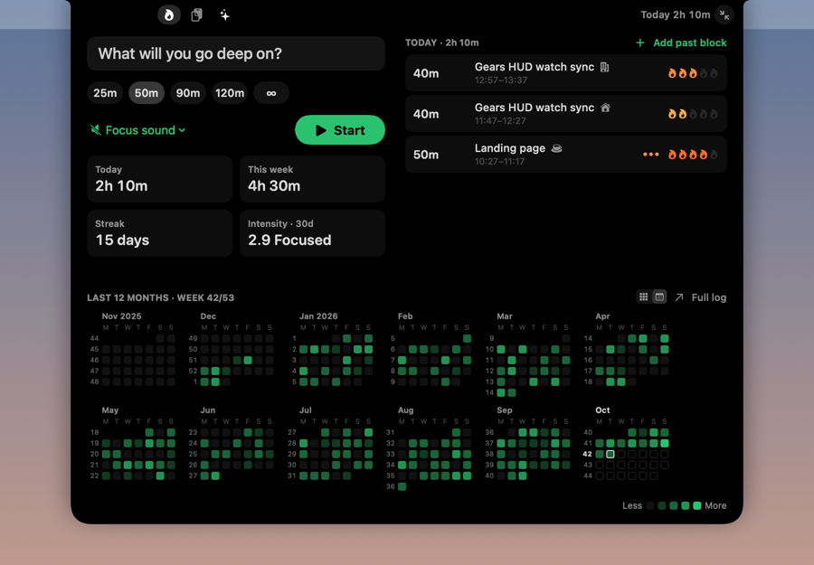
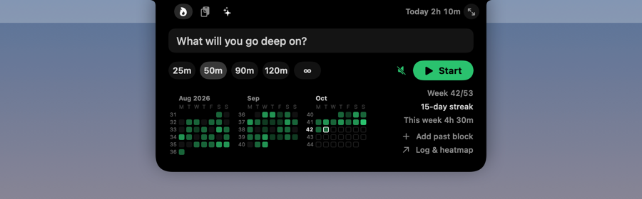
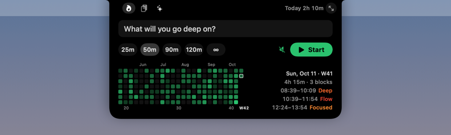
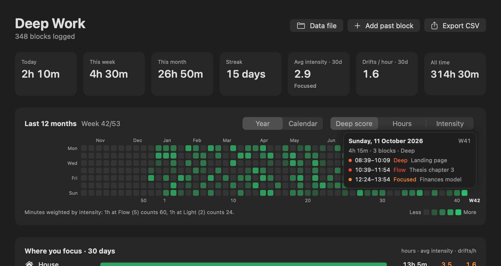
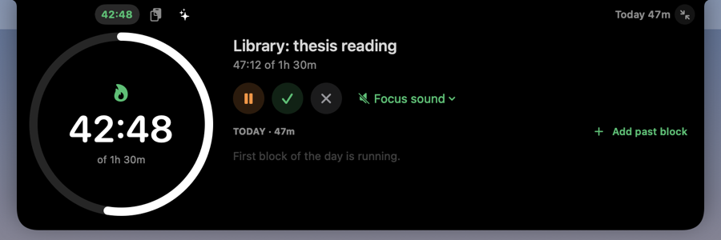
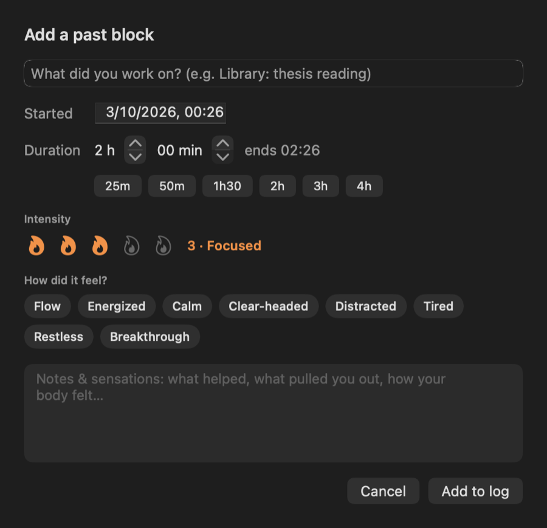
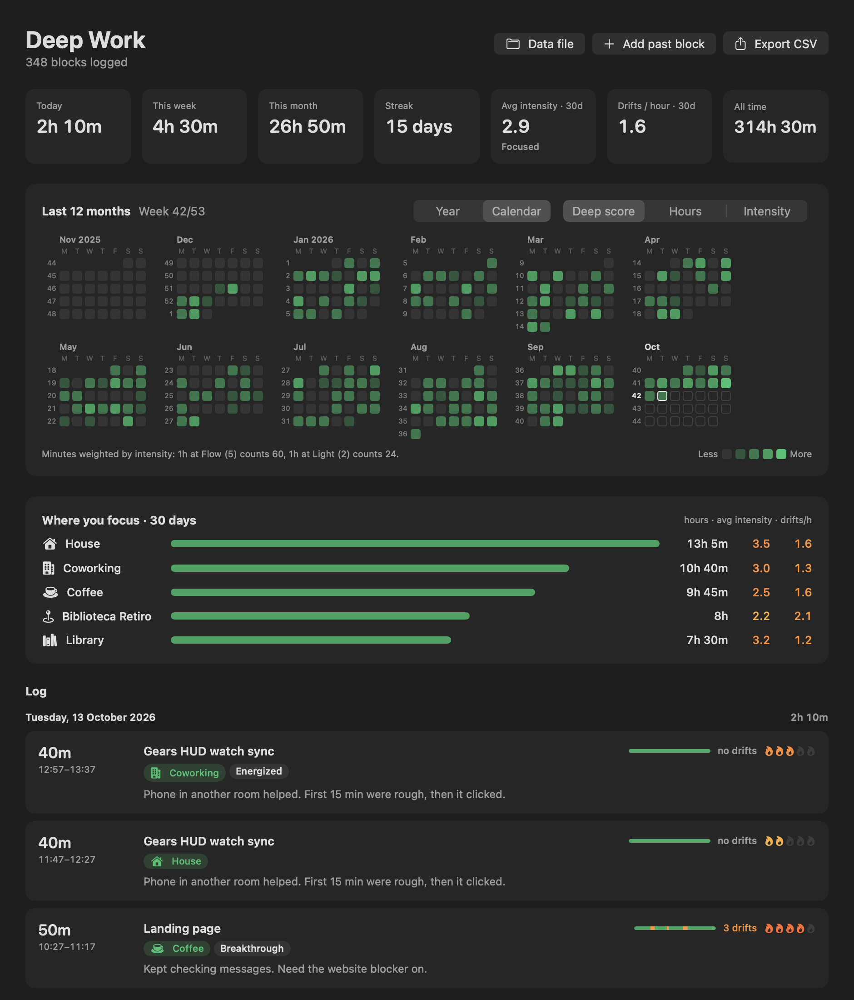
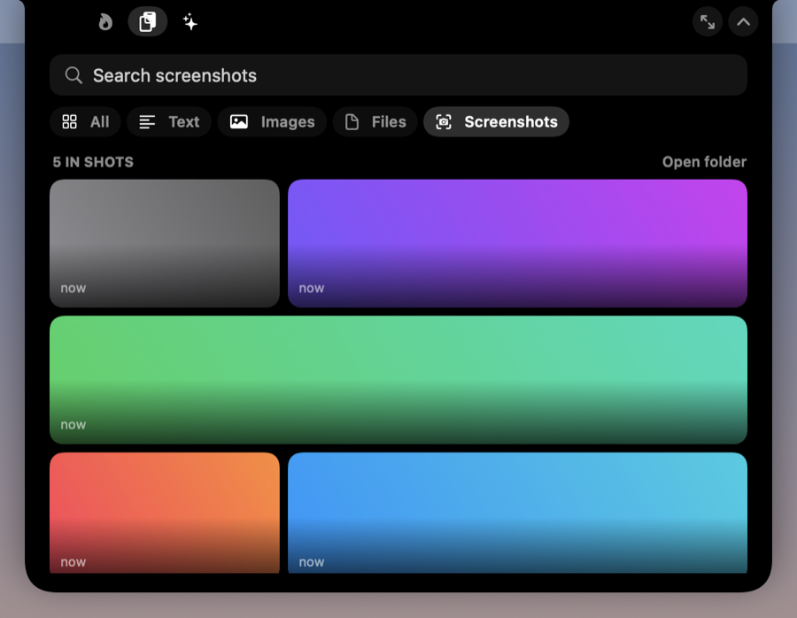

# GNotch

The Gears notch app for macOS. One notch, three pages that swap in place:

- **Deep Work**: a timer for deep work blocks with a log of every block, intensity ratings, notes on how it felt, and a GitHub-style heatmap of the year
- **Clipboard**: history of everything you copy (text, images, files), with pins and search, plus **Ubuntu-style screenshots** (every screenshot is instantly on your clipboard)
- **Vision Board**: images and quotes as home-screen-style widgets

**On Ubuntu?** There's a GNOME Shell extension with the same three pages (timer with drift tracker and heatmap, clipboard, vision board) in the top bar, sharing the same data formats: [linux/gnome-extension](linux/gnome-extension/README.md).

*GNotch was called "DeepWork Tracker" until v0.4; data and settings migrate automatically.*




## What it does

- **Lives in the notch.** Hover the notch to expand it. Pick a block length (25 / 50 / 90 / 120 min, or ∞ open-ended), name what you're working on, start.
- **Progress traced along the notch.** While a block runs, a line draws itself just outside the notch outline (so the camera housing never hides it): down the left side, across the bottom, up the right. Green while running, orange when paused, pulsing once you pass your goal (it chimes and keeps counting overtime, so it never breaks your flow). Open-ended blocks fill the outline once per hour. The countdown sits beside the notch; turn that off in the menu (*Show Time Beside Notch*) for outline only.
- **Mini heatmap in the notch.** The last 24 weeks, streak, and this week's total, right under the Start button.
- **Log every block.** When you finish, the notch asks for:
  - **Intensity** 1–5 (Shallow · Light · Focused · Deep · Flow)
  - **Sensations** as quick tags (Flow, Energized, Calm, Clear-headed, Distracted, Tired, Restless, Breakthrough)
  - **Notes**: what helped, what pulled you out, how your body felt
  
  `⌘↩` saves.
- **Heatmap + log window.** Menu bar icon → *Log & Heatmap* (or the link in the notch). Three heatmap modes:
  - **Deep score**: minutes × intensity / 5. An hour at Flow counts more than an hour at Light.
  - **Hours**: raw time.
  - **Intensity**: average intensity for the day.
  
  Click a day to filter the log. Click a block to edit it or delete it. Stats: today, week, month, streak, 30-day average intensity, all time.
- **Two heatmap views** (switch with *Year | Calendar* in the dashboard or the big timer page; the notch follows):
  - **Year**: the GitHub-style grid, zoomed out to see the trend. Month names on top, week numbers underneath (1, 10, 20, 30, 40, 50 and this week, e.g. **W42**).
  - **Calendar**: month calendars, days left to right, every week numbered, days ahead outlined so you can plan. In the notch it shows the last three months.
  - The current week is always in the header: **Week 42/53** (ISO weeks).
- **Hover a day** for a quick look: date, week, total, and every block with its start–end time and intensity. In the notch the details appear beside the heatmap; in the dashboard and big timer page as a small card.
- **Place.** When you finish (or add) a block, pick where it happened: Library, House, Coworking, Coffee, or *Other…* to type your own (remembered for next time). It defaults to your last place. The dashboard's **Where you focus** card compares places over 30 days: hours, average intensity and drifts per hour.
- **Drift tracker.** Lost focus? Hit pause (or **⌃⌥P** from anywhere). Each pause is logged as a *drift*, and the notch turns into a breathing guide (4 s in, 6 s out) until you resume. A bar under the timer shows the block so far: green while focused, orange where you drifted. Small orange dots beside the collapsed notch count the drifts. The finish form, the log and the dashboard show drifts per block, and the dashboard tracks **drifts per focused hour** over 30 days. When the Mac goes to sleep it pauses too, but that isn't counted as a drift.
- **Big mode (⤢).** The timer page grows into a focus screen: large countdown ring, today's blocks, stats and the full-year heatmap. In big mode the notch stays open while a block runs (Esc or ⌃ to tuck it away).
- **Sounds.** Soft system sounds on start, pause, goal and save (toggle: menu bar → *Timer Sounds*). Optional **focus sound** while a block runs: brown, pink or white noise, or ocean waves, generated live with no audio files. It fades out when you pause.
- **Add past blocks.** Worked in the library, or forgot to start the timer? *Add past block* (in the notch or the dashboard): start time, duration (quick 25m…4h buttons), intensity, feelings, notes. It warns if the block overlaps one already logged. Manual blocks show a ✎ in the log, and any block's times can be edited later.
- **Survives restarts.** A running block is saved, so quitting or rebooting doesn't lose it. The timer auto-pauses when the Mac sleeps.












## Pages, shortcuts and opening the notch

| | |
|---|---|
| **Hover** the notch | Peeks open; closes when you move away |
| **Click** inside it | Stays open until **Esc**, the ⌃ button, or a click elsewhere |
| **⌃⌥D** | Timer |
| **⌃⌥V** | Clipboard (search is focused: type, **↩** copies the top match) |
| **⌃⌥B** | Vision Board |
| **⌃⌥P** | I drifted: pause the block and breathe (again to resume) |
| ⤢ button | Bigger layout for any page |

The small icons left of the notch switch pages; while a block runs, the timer icon shows the countdown.

## Clipboard


- Everything you copy is kept: text, links, images, files, laid out as a packed grid: short text takes one column, long text and wide images take more. The last 10 show at a glance; **Show all** opens the full history (500 items, 80 images).
- Filter by **All · Text · Images · Files · Screenshots**.
- **Click** an item to copy it again. **Drag** it out to drop it into any app. Right-click: pin, open link, show in Finder, add to Vision Board, delete.
- **Pin** favourites so they stay at the top and never expire.
- **Search** everything, including file paths and the app it came from.
- **Drag anything onto the notch** → drop on *Clipboard*.
- **Password managers are skipped**: anything marked concealed or transient ([nspasteboard.org](http://nspasteboard.org) convention, used by 1Password, Bitwarden, KeePassXC…), and anything copied while a password manager is in front.
- Pause or clear the history from the menu bar icon. History is stored only on this Mac, unencrypted, in `~/Library/Application Support/GNotch/Clipboard/`.

### Screenshots, the Ubuntu way



Take a screenshot (⇧⌘3 / ⇧⌘4 / ⇧⌘5) and it's **already on your clipboard**: press ⌘V anywhere. It also goes into the history, and **Clipboard → Screenshots** shows every screenshot in your screenshot folder to copy or drag again.

macOS waits ~5 s (floating thumbnail) before saving a screenshot; menu bar → **Instant Screenshots** or [`scripts/screenshots.sh enable`](scripts/screenshots.sh) removes the wait. Full details: [docs/SCREENSHOTS.md](docs/SCREENSHOTS.md).

## Vision Board


Widgets like on an iPhone or Android home screen. Drag images (or image files) onto the notch and drop on *Vision Board*, add a note (a goal, a quote), or **Paste** what's on the clipboard.

- **Drag** a widget: the others move out of the way, and nothing ever overlaps.
- Click to select, then drag the white corner handle to **resize**; it snaps to the 6-column grid (or right-click → *Size*).
- **Double-click** to see it big. Right-click: copy image, show in Finder, remove.
- **Tidy** resets sizes and puts the newest first.

## Build & install

Requires macOS 14+ and Swift 5.9+. Xcode's Command Line Tools are enough; you don't need full Xcode.

```bash
./scripts/build-app.sh            # builds build/GNotch.app
./scripts/build-app.sh --install  # also copies it to /Applications and launches it
```

There's no Dock icon. Look for the 🧠 icon in the menu bar. *Launch at Login* is in that menu.

> If you run another notch app at the same time, they'll draw on top of each other. Quit the other one.

## Data

Everything is local, in one human-readable file:

```
~/Library/Application Support/GNotch/sessions.json
```

```json
{
  "version": 1,
  "sessions": [
    {
      "id": "…", "start": "2026-10-03T09:12:00Z", "end": "2026-10-03T10:04:00Z",
      "duration": 3120, "plannedMinutes": 50, "task": "Thesis chapter 3",
      "intensity": 4, "tags": ["Flow", "Calm"], "notes": "Phone in another room helped.",
      "pauses": [{ "start": "2026-10-03T09:31:00Z", "end": "2026-10-03T09:33:10Z" }],
      "location": "Library"
    }
  ]
}
```

`duration` is in active seconds, excluding pauses. `pauses` lists the drifts (`"auto": true` marks a pause caused by the Mac sleeping); it's missing on blocks logged before drift tracking and on blocks added by hand. `manual: true` marks blocks added by hand. `location` is the place tag (optional). The format is deliberately simple so other clients (e.g. the Gears HUD watch app) can read and append to it. You can also export it as CSV from the dashboard.

## Development

```
Sources/GNotch/
  AppDelegate.swift      menu bar item, dashboard window, app menu, shortcuts
  ScreenshotLibrary.swift  screenshot folder watcher, auto-copy, screenshot settings
  Sounds.swift           event sounds + generated focus sounds
  TimerLarge.swift       big timer page
  NotchController.swift  the floating panel over the notch: hover, pin, click-through, Esc
  NotchRoot.swift        page switching, top band tabs, drop targets
  ClipboardStore.swift   pasteboard watcher, history storage, drop parsing
  ClipboardPage.swift    clipboard UI
  VisionBoard.swift      vision board storage + UI
  HotKeys.swift          global shortcuts (Carbon, no permissions needed)
  NotchViews.swift       collapsed / idle / running / finish UI
  TimerEngine.swift      timer state machine (idle → running ⇄ paused → finishing)
  SessionStore.swift     JSON persistence + stats
  DashboardView.swift    stats, heatmap card, log, editor
  HeatmapView.swift      year grid and month calendars, week numbers, hover card
  Components.swift       shared pieces (notch shape, intensity picker, tags…)
  Snapshots.swift        renders UI states to PNG with sample data
```

Render every UI state to PNGs without touching your real data (useful for checking UI changes):

```bash
swift build -c release && GNOTCH_SNAPSHOT=/tmp/gnotch-shots .build/release/GNotch
```

Regenerate the app icon: `swift scripts/make-icon.swift && iconutil -c icns Resources/AppIcon.iconset -o Resources/AppIcon.icns`

## Roadmap

- [x] Ubuntu: GNOME Shell extension with timer, drifts, places, heatmap, clipboard and vision board ([linux/gnome-extension](linux/gnome-extension/README.md))
- [ ] Ubuntu: dashboard/log window and past blocks

- [ ] Gears HUD (Wear OS) companion: start/stop from the watch, sync `sessions.json`
- [x] Global shortcuts (⌃⌥D / ⌃⌥V / ⌃⌥B)
- [ ] Customisable shortcuts
- [ ] Manual entry for blocks done away from the Mac
- [ ] Weekly review: intensity trends, best time of day, which tags go with high intensity
