# GNotch

The Gears notch app for macOS. One notch, three pages that swap in place:

- **Deep Work**: a timer for deep work blocks with a log of every block, intensity ratings, notes on how it felt, and a GitHub-style heatmap of the year
- **Clipboard**: history of everything you copy (text, images, files), with pins and search, plus **Ubuntu-style screenshots** (every screenshot is instantly on your clipboard) and **Text to .md** (title + long pasted text → a Markdown file, ready to paste)
- **Vision Board**: images and quotes as home-screen-style widgets

**On Ubuntu?** There's a GNOME Shell extension with the same three pages (timer with drift tracker and heatmap, clipboard, vision board) in the top bar, sharing the same data formats: [linux/gnome-extension](linux/gnome-extension/README.md).

*GNotch was called "DeepWork Tracker" until v0.4; data and settings migrate automatically.*

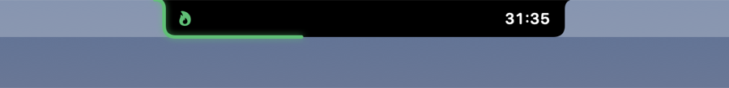
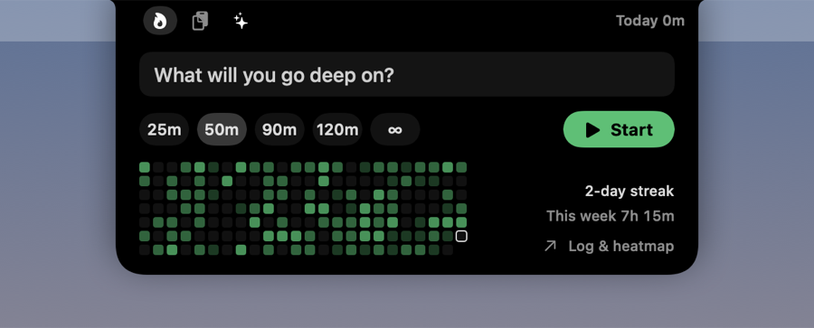
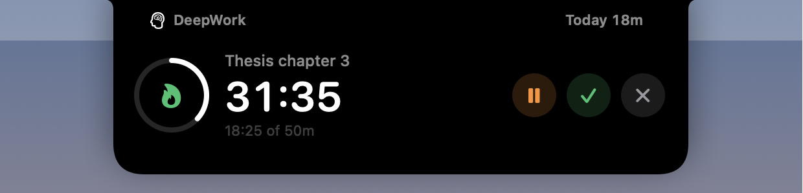
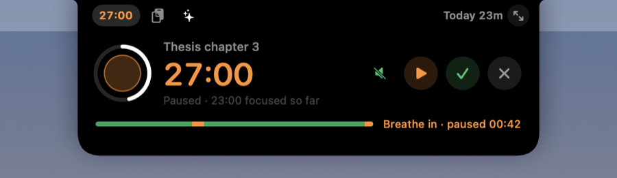

## What it does

- **Lives in the notch.** Hover the notch to expand it. Pick a block length (25 / 50 / 90 / 120 min, or ∞ open-ended), name what you're working on, start.
- **Progress traced along the notch.** While a block runs, a line draws itself just outside the notch outline (so the camera housing never hides it): down the left side, across the bottom, up the right. Green while running, orange when paused, pulsing once you pass your goal (it chimes and keeps counting overtime, so it never breaks your flow). Open-ended blocks fill the outline once per hour. The countdown sits beside the notch; turn that off in the menu (*Show Time Beside Notch*) for outline only.
- **Mini heatmap in the notch.** The last 24 weeks, streak, and this week's total, right under the Start button.
- **Log every block.** When you finish, the notch asks for:
  - **Intensity** 1–5 (Shallow · Light · Focused · Deep · Flow)
  - **Sensations** as quick tags (Flow, Energized, Calm, Clear-headed, Distracted, Tired, Restless, Breakthrough)
  - **Notes**: what helped, what pulled you out, how your body felt
  
  `⌘↩` saves.
- **Heatmap + log window.** Menu bar icon → *Log & Heatmap* (or the link in the notch). Three heatmap modes:
  - **Deep score**: minutes × intensity / 5. An hour at Flow counts more than an hour at Light.
  - **Hours**: raw time.
  - **Intensity**: average intensity for the day.
  
  Click a day to filter the log. Click a block to edit it or delete it. Stats: today, week, month, streak, 30-day average intensity, all time.
- **Two heatmap views** (switch with *Year | Calendar* in the dashboard or the big timer page; the notch follows):
  - **Year**: the GitHub-style grid, zoomed out to see the trend. Month names on top, week numbers underneath (1, 10, 20, 30, 40, 50 and this week, e.g. **W42**).
  - **Calendar**: month calendars, days left to right, every week numbered, days ahead outlined so you can plan. In the notch it shows the last three months.
  - The current week is always in the header: **Week 42/53** (ISO weeks).
- **Hover a day** for a quick look: date, week, total, and every block with its start–end time and intensity. In the notch the details appear beside the heatmap; in the dashboard and big timer page as a small card.
- **Place.** When you finish (or add) a block, pick where it happened: Library, House, Coworking, Coffee, or *Other…* to type your own (remembered for next time). It defaults to your last place. The dashboard's **Where you focus** card compares places over 30 days: hours, average intensity and drifts per hour.
- **Drift tracker.** Lost focus? Hit pause (or **⌃⌥P** from anywhere). Each pause is logged as a *drift*, and the notch turns into a breathing guide (4 s in, 6 s out) until you resume. A bar under the timer shows the block so far: green while focused, orange where you drifted. Small orange dots beside the collapsed notch count the drifts. The finish form, the log and the dashboard show drifts per block, and the dashboard tracks **drifts per focused hour** over 30 days. When the Mac goes to sleep it pauses too, but that isn't counted as a drift.
- **Big mode (⤢).** The timer page grows into a focus screen: large countdown ring, today's blocks, stats and the full-year heatmap. In big mode the notch stays open while a block runs (Esc or ⌃ to tuck it away).
- **Sounds.** Soft system sounds on start, pause, goal and save (toggle: menu bar → *Timer Sounds*). Optional **focus sound** while a block runs: brown, pink or white noise, or ocean waves, generated live with no audio files. It fades out when you pause.
- **Add past blocks.** Worked in the library, or forgot to start the timer? *Add past block* (in the notch or the dashboard): start time, duration (quick 25m…4h buttons), intensity, feelings, notes. It warns if the block overlaps one already logged. Manual blocks show a ✎ in the log, and any block's times can be edited later.
- **Today's timeline.** A line under the notch heatmap says when the Mac was first opened today (boot, login, wake or screen on) and when Claude first opened, e.g. *On past midnight · opened 02:14 · Claude 14:18*, with a midnight-to-midnight strip (green while the Mac was on, white ticks where an app opened). Hover it for the list: screen on/off, sleep/wake, shutdown, boot, login, app opens. macOS Screen Time doesn't show this. GNotch logs these moments itself while it runs and fills in the hours before it started from the system (boot, shutdown and logins as `last` sees them, screen and sleep/wake from `pmset -g log`, the launch time of apps still running). Watch other apps with `defaults write com.christianqp4.GNotch timelineApps -array com.anthropic.claudefordesktop com.apple.Safari`.
- **Survives restarts.** A running block is saved, so quitting or rebooting doesn't lose it. The timer auto-pauses when the Mac sleeps.

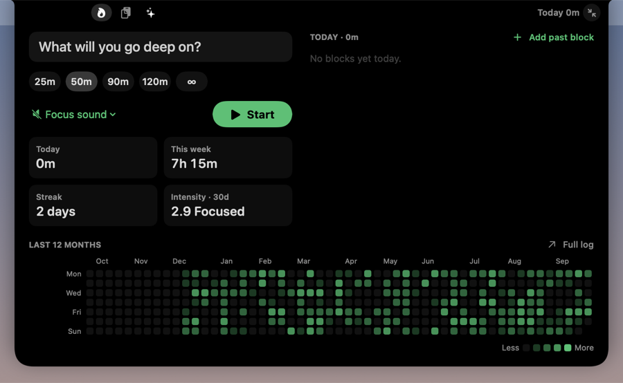
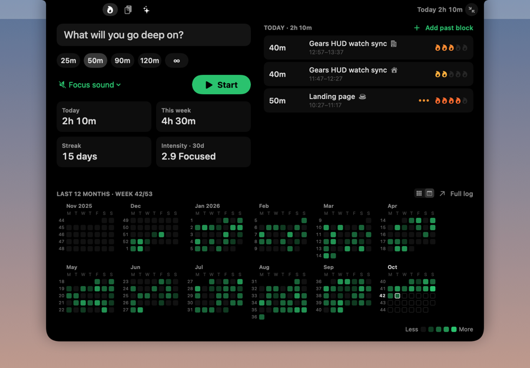
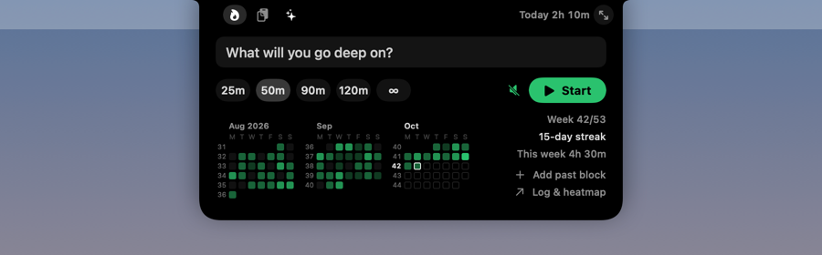
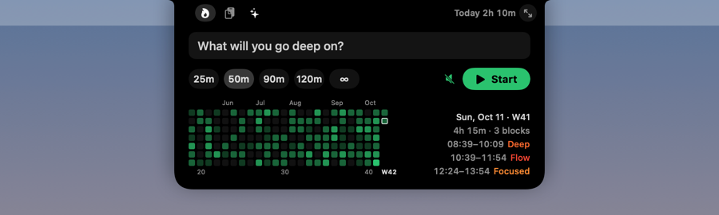
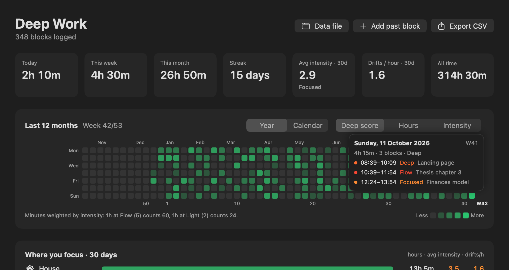
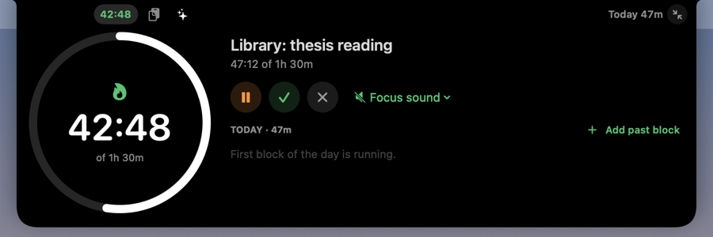
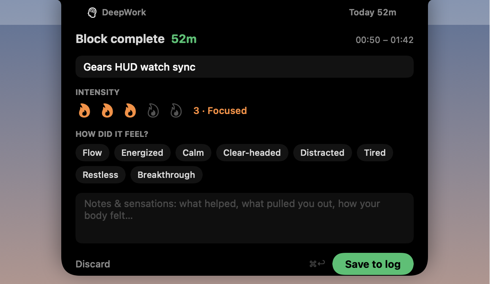
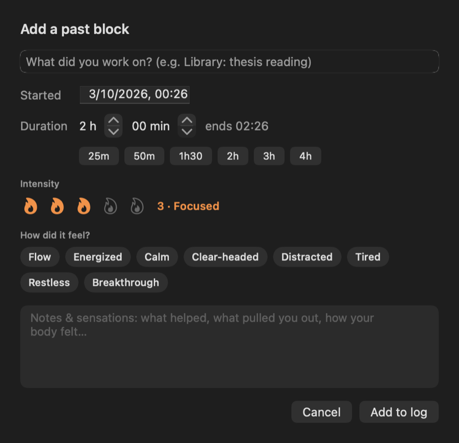
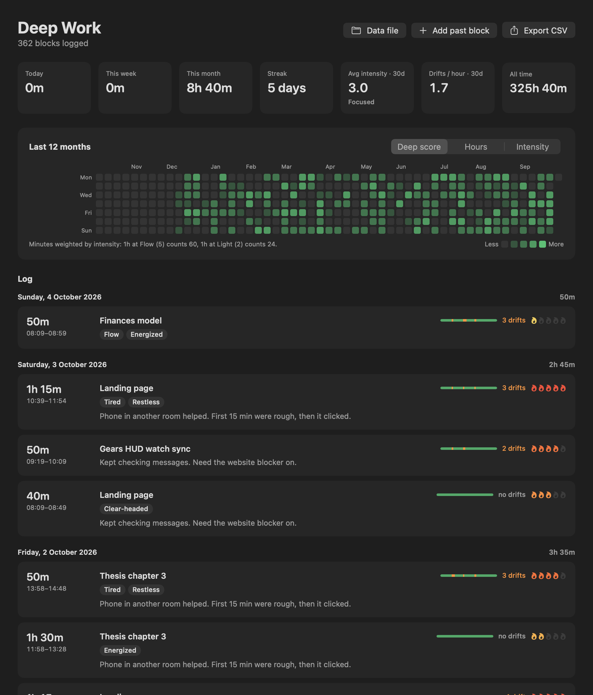
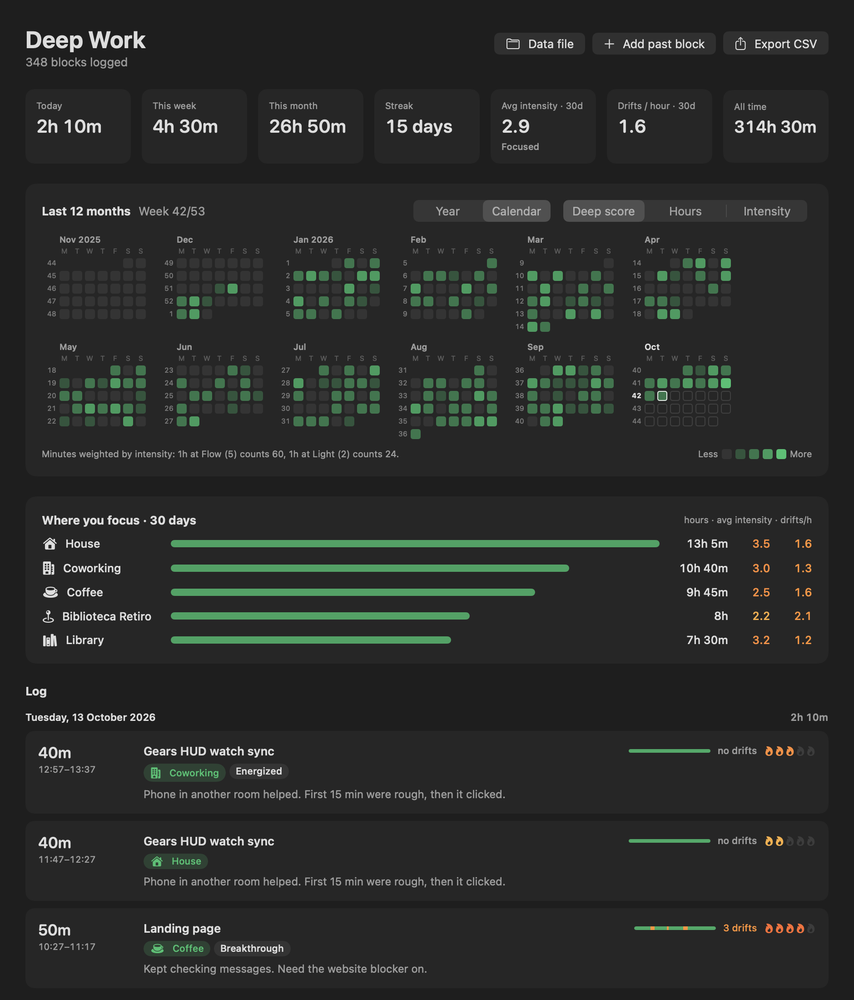

## Pages, shortcuts and opening the notch

| | |
|---|---|
| **Hover** the notch | Peeks open; closes when you move away |
| **Click** inside it | Stays open until **Esc**, the ⌃ button, or a click elsewhere |
| **⌃⌥D** | Timer |
| **⌃⌥V** | Clipboard (search is focused: type, **↩** copies the top match) |
| **⌃⌥B** | Vision Board |
| **⌃⌥M** | Text to .md (the title is focused) |
| **⌃⌥P** | I drifted: pause the block and breathe (again to resume) |
| **⌃⌥Q** | Questions from the chats, one card at a time |
| ⤢ button | Bigger layout for any page |

The small icons left of the notch switch pages; while a block runs, the timer icon shows the countdown.

## Questions from the chats

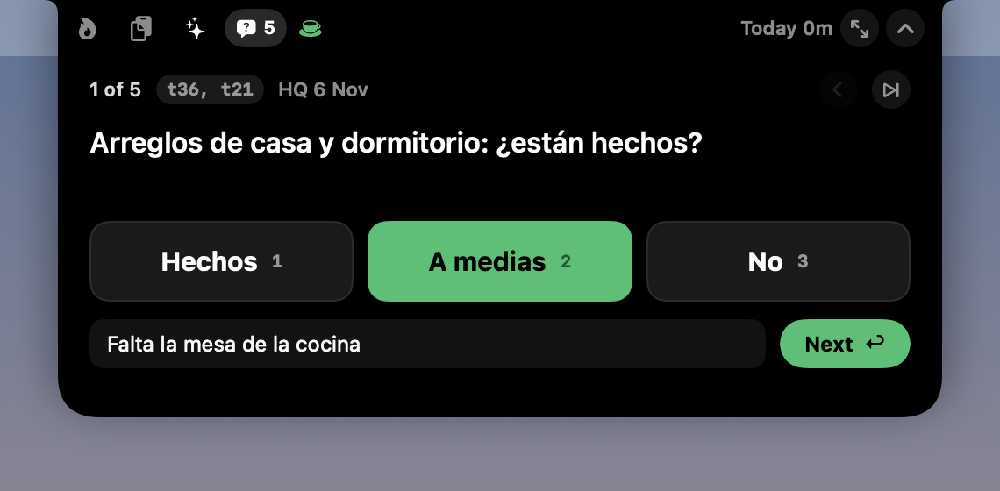

The Gears chats ask yes/no questions to close or update tasks ("¿ya firmaste el contrato?"). Instead of answering them in a chat, answer them in the notch: a blue bubble with a count shows in the top band while questions are open. Click it (or **⌃⌥Q**) and they come one card at a time.

- **Y / N** (or **1–9** for the options) picks, **↩** saves and shows the next one. **C** writes a comment first, just in case. **→** leaves a card for later, **←** goes back to change the last answer.
- When none are left it says so; the bubble disappears.
- **Reminder:** *Cerrar el día* (see Reminders below) sends one silent notification when questions are open, and none when there aren't. Click it to open the queue.
- The bubble hides during the night's quiet stretch; ⌃⌥Q still opens the queue.

The questions live in `~/gears_OS/dashboard/questions.json` (its `about` field explains the format). Chats append questions; GNotch only shows them and writes `answer`, `comment` and `answeredAt` back. It knows nothing about tasks: the day chat or *log the day* reads the answers and updates `tasks.json`.

- Answers go into the file as it is on disk at that moment (read again, changed, written to a temporary file and swapped in), so a question a chat appended a second earlier is kept, and so are fields GNotch doesn't know. If the file can't be read (a chat halfway through writing it), nothing is written and the card says so.
- GNotch looks at the file's date every 15 s and reads it only when it changed.
- Yes/no answers are stored as `"yes"` / `"no"`; choices as the option's label; text questions as the text.

Mac only for now: the Ubuntu extension doesn't have this. Dev check (temporary copy, never the real file): `GNOTCH_QUESTIONS_CHECK=1 .build/release/GNotch`.

## Reminders (Recordatorios)

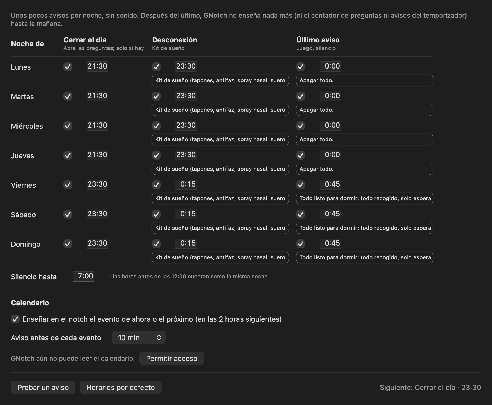

A few quiet reminders a night, and nothing else in GNotch notifies. Menu bar → **Recordatorios…** (it also shows the next one). Every reminder is a silent macOS notification; macOS asks once to allow them (**Probar un aviso** sends one now).

- **Per weekday night**, each on/off with its time and text. Times before 12:00 count as the same night, after midnight. Defaults:
  - Mon–Thu: *Cerrar el día* 21:30 · *Desconexión* 23:30 (sleep kit and tidy up) · *Último aviso* 00:00 (switch everything off)
  - Fri–Sun (shift nights, home ~23:30): *Cerrar el día* 23:30 · *Desconexión* 00:15 · *Último aviso* 00:45 (everything ready for sleep, only waiting up)
- *Cerrar el día* only fires when the question queue has open questions, and clicking it opens the queue.
- **Quiet stretch:** after the night's last reminder, until 07:00 (*Silencio hasta*), GNotch shows nothing on its own: no question bubble, no calendar line or alerts, no peek when a block reaches its goal. Things you do yourself still work.
- If the Mac was asleep at a reminder's time, it comes on wake, up to 90 minutes late, never later.

### Calendar

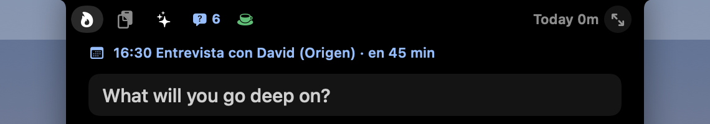

- The event on now, or the next one within 2 hours, shows as one line under the notch's top band, on every page.
- An optional alert before each event (default 10 min; 5, 10, 15, 30 or none): a silent notification plus the time beside the closed notch for a few seconds. All-day, cancelled and declined events are skipped.
- It reads macOS Calendar through EventKit (read-only). Access is asked once, the first time the notch opens. A Google calendar shows up once the account is added in **System Settings → Internet Accounts → Google** with Calendars on; the window says whether it found one. There's no Google login inside GNotch.
- It reads the next 36 hours when something changes (the calendar, waking up, a reminder's time), never on a polling loop.
- GNotch is ad-hoc signed, so macOS may ask for Calendar access again after a rebuild.

## Keep-awake status

The cup on the right of the top band (next to **Today** on the timer page) says whether this Mac will stay awake, on every page: **On** in green (with the time left if there's room), **Off** in grey, **Claude** in orange. Hover or click it for the details (click it to turn it on or off, see below): time left and when it ends, AC or battery, and what it takes to drive chats from the phone (lid open, Claude app open, Wi-Fi, charger).

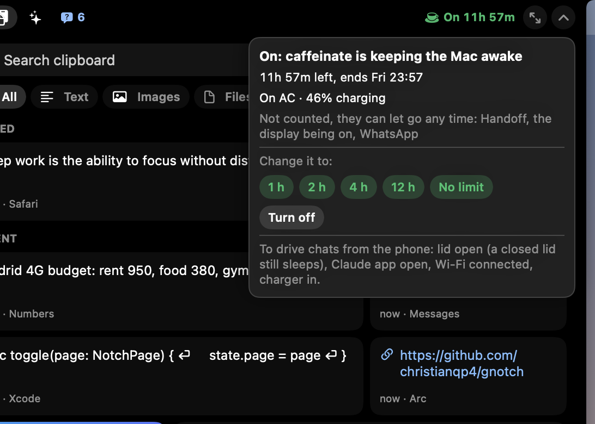

- **On** means a real `caffeinate` is holding the Mac (`caffeinate -is -t 43200`, say). `-s` alone doesn't count on battery, where macOS ignores it, and `-d` alone doesn't count because it only keeps the display on.
- **Claude** means only the Claude app is holding it, which lasts only while a chat is working.
- **Off** can still have other apps holding the Mac for now (a camera in WhatsApp, Handoff, the display being on). The card lists them, but they can let go at any time, so they don't count.
- **Turn it on from GNotch**: click the cup, then **1 h · 2 h · 4 h · 12 h · No limit**. That runs `caffeinate -is` (with `-t` for the hours): no idle sleep, and no system sleep while on AC. Pick another length to replace it, or **Turn off**. The same choices are in the menu bar under **Keep Awake**.
- **Turn off** stops every `caffeinate` holding the Mac, including one a chat started by hand. Nothing else is touched (it checks the process name before stopping it).
- The `caffeinate` isn't tied to GNotch: it keeps running if GNotch quits or is reinstalled, and ends on its own when the time runs out.
- A closed lid still sleeps; `caffeinate` can't stop that.
- It reads `pmset -g assertions` and `pmset -g batt` when the notch opens, every 30 s while it's open, and right after you change it. It can't tell whether the lid is closed.

## Clipboard

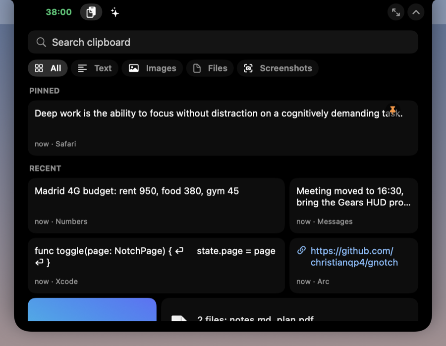

- Everything you copy is kept: text, links, images, files, laid out as a packed grid: short text takes one column, long text and wide images take more. The last 10 show at a glance; **Show all** opens the full history (500 items, 80 images).
- Filter by **All · Text · Images · Files · Screenshots**.
- **Click** an item to copy it again. **Drag** it out to drop it into any app. Right-click: pin, open link, show in Finder, add to Vision Board, delete.
- **Pin** favourites so they stay at the top and never expire.
- **Search** everything, including file paths and the app it came from.
- **Drag anything onto the notch** → drop on *Clipboard*.
- **Password managers are skipped**: anything marked concealed or transient ([nspasteboard.org](http://nspasteboard.org) convention, used by 1Password, Bitwarden, KeePassXC…), and anything copied while a password manager is in front.
- Pause or clear the history from the menu bar icon. History is stored only on this Mac, unencrypted, in `~/Library/Application Support/GNotch/Clipboard/`.

### Text to .md

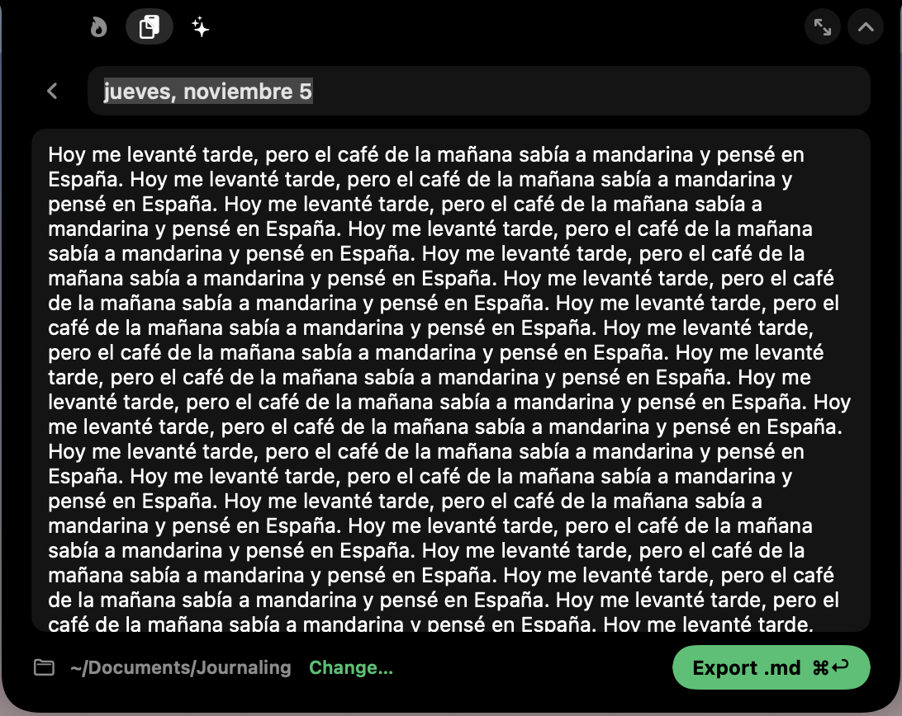

Turn a long text (a journaling transcription, say) into a file you can paste into a chat, faster than opening an editor: **⌃⌥M**, type the title, **↩**, **⌘V**, **⌘↩**. The **.md** button beside the clipboard search opens the same form.

- The file is named after the title (`jueves, noviembre 5.md`; accents and spaces stay, `/` and `:` become `-`). An empty title uses today's date in that format.
- The content is `# title`, a blank line, then the text byte for byte. Smart quotes, autocorrect and the like are off in the text area.
- It never overwrites: a second file with the same title becomes `jueves, noviembre 5 (2).md`.
- The file itself goes on the clipboard (as a file URL, like Finder's Copy), not its text and not its path as text, so ⌘V attaches the file. It also shows in the history as a file tile: click to copy it again, drag it out, or right-click → Show in Finder.
- The text entry left in the history by copying that same text is removed (unless pinned), so the journal isn't stored twice. Copying the text and editing it first leaves that entry alone.
- Files go to `~/Documents/Journaling` by default, outside any repo. The folder is shown in the form: click it to open it in Finder, or **Change…** to pick another (it's remembered). macOS may ask once for access to Documents.
- A half-finished draft survives closing the notch or switching page, but not quitting GNotch. It's only in memory; nothing is written until you export.

Mac only for now: the Ubuntu extension doesn't have this.

### Screenshots, the Ubuntu way

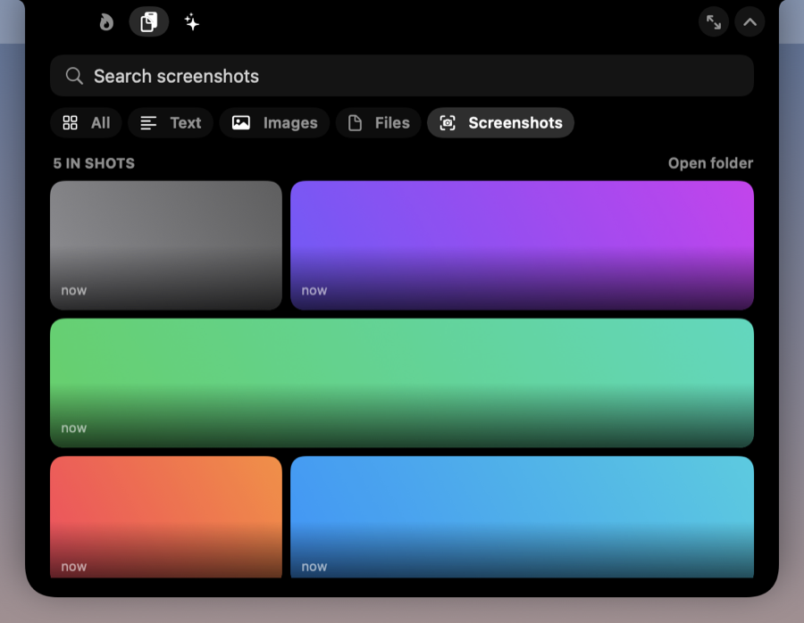

Take a screenshot (⇧⌘3 / ⇧⌘4 / ⇧⌘5) and it's **already on your clipboard**: press ⌘V anywhere. It also goes into the history, and **Clipboard → Screenshots** shows every screenshot in your screenshot folder to copy or drag again.

macOS waits ~5 s (floating thumbnail) before saving a screenshot; menu bar → **Instant Screenshots** or [`scripts/screenshots.sh enable`](scripts/screenshots.sh) removes the wait. Full details: [docs/SCREENSHOTS.md](docs/SCREENSHOTS.md).

## Vision Board

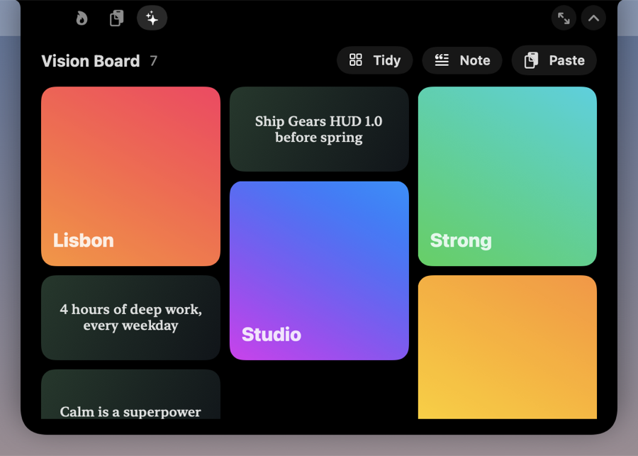
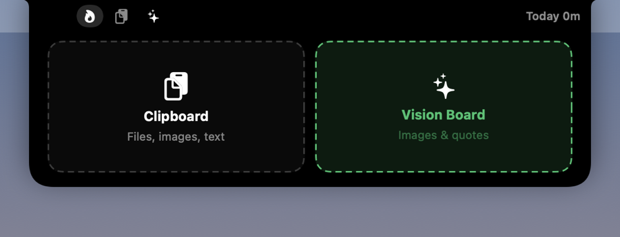

Widgets like on an iPhone or Android home screen. Drag images (or image files) onto the notch and drop on *Vision Board*, add a note (a goal, a quote), or **Paste** what's on the clipboard.

- **Drag** a widget: the others move out of the way, and nothing ever overlaps.
- Click to select, then drag the white corner handle to **resize**; it snaps to the 6-column grid (or right-click → *Size*).
- **Double-click** to see it big. Right-click: copy image, show in Finder, remove.
- **Tidy** resets sizes and puts the newest first.

## Build & install

Requires macOS 14+ and Swift 5.9+. Xcode's Command Line Tools are enough; you don't need full Xcode.

```bash
./scripts/build-app.sh            # builds build/GNotch.app
./scripts/build-app.sh --install  # also copies it to /Applications and launches it
```

There's no Dock icon. Look for the 🧠 icon in the menu bar. *Launch at Login* is in that menu.

> If you run another notch app at the same time, they'll draw on top of each other. Quit the other one.

## Data

Everything is local, in one human-readable file:

```
~/Library/Application Support/GNotch/sessions.json
```

```json
{
  "version": 1,
  "sessions": [
    {
      "id": "…", "start": "2026-10-03T09:12:00Z", "end": "2026-10-03T10:04:00Z",
      "duration": 3120, "plannedMinutes": 50, "task": "Thesis chapter 3",
      "intensity": 4, "tags": ["Flow", "Calm"], "notes": "Phone in another room helped.",
      "pauses": [{ "start": "2026-10-03T09:31:00Z", "end": "2026-10-03T09:33:10Z" }],
      "location": "Library"
    }
  ]
}
```

`duration` is in active seconds, excluding pauses. `pauses` lists the drifts (`"auto": true` marks a pause caused by the Mac sleeping); it's missing on blocks logged before drift tracking and on blocks added by hand. `manual: true` marks blocks added by hand. `location` is the place tag (optional). The format is deliberately simple so other clients (e.g. the Gears HUD watch app) can read and append to it. You can also export it as CSV from the dashboard.

Today's timeline is logged next to it in `timeline.jsonl`, one event per line, e.g. `{"date":"2026-10-24T12:18:43Z","kind":"launch","app":"Claude"}` (kinds: `boot`, `login`, `wake`, `sleep`, `displayOn`, `displayOff`, `shutdown`, `launch`, `quit`).

## Development

```
Sources/GNotch/
  AppDelegate.swift      menu bar item, dashboard window, app menu, shortcuts
  ScreenshotLibrary.swift  screenshot folder watcher, auto-copy, screenshot settings
  Sounds.swift           event sounds + generated focus sounds
  TimerLarge.swift       big timer page
  NotchController.swift  the floating panel over the notch: hover, pin, click-through, Esc
  NotchRoot.swift        page switching, top band tabs, drop targets
  ClipboardStore.swift   pasteboard watcher, history storage, drop parsing
  ClipboardPage.swift    clipboard UI
  TextExport.swift       Text to .md: file naming and writing, draft, form, plain text area
  KeepAwake.swift        keep-awake: pmset parsing, monitor, turning caffeinate on/off, cup badge, card
  VisionBoard.swift      vision board storage + UI
  HotKeys.swift          global shortcuts (Carbon, no permissions needed)
  NotchViews.swift       collapsed / idle / running / finish UI
  TimerEngine.swift      timer state machine (idle → running ⇄ paused → finishing)
  SessionStore.swift     JSON persistence + stats
  DashboardView.swift    stats, heatmap card, log, editor
  HeatmapView.swift      year grid and month calendars, week numbers, hover card
  DayTimeline.swift      today's timeline: event log, system sources (wtmp, pmset), strip and hover list
  Components.swift       shared pieces (notch shape, intensity picker, tags…)
  Snapshots.swift        renders UI states to PNG with sample data
```

Render every UI state to PNGs without touching your real data (useful for checking UI changes):

```bash
swift build -c release && GNOTCH_SNAPSHOT=/tmp/gnotch-shots .build/release/GNotch
```

Check Text to .md the same way, writing only into the folder you name (the pasteboard writes are marked transient, so a running GNotch doesn't record them; the test file stays on your clipboard afterwards):

```bash
GNOTCH_EXPORT_CHECK=sample.txt GNOTCH_EXPORT_FOLDER=/tmp/gnotch-export GNOTCH_EXPORT_TITLE="jueves, noviembre 5" .build/release/GNotch
```

Check the keep-awake parser against real `pmset` samples and print the live state (read-only): `GNOTCH_KEEPAWAKE_CHECK=1 .build/release/GNotch`. Add `GNOTCH_KEEPAWAKE_LIVE=1` to also turn it on for 1 h, change it to 4 h and turn it off for real (skipped if a `caffeinate` is already running).

Regenerate the app icon: `swift scripts/make-icon.swift && iconutil -c icns Resources/AppIcon.iconset -o Resources/AppIcon.icns`

## Roadmap

What changed in each version: [CHANGELOG.md](CHANGELOG.md).

- [x] Ubuntu: GNOME Shell extension with timer, drifts, places, heatmap, clipboard and vision board ([linux/gnome-extension](linux/gnome-extension/README.md))
- [ ] Ubuntu: dashboard/log window and past blocks

- [ ] Gears HUD (Wear OS) companion: start/stop from the watch, sync `sessions.json`
- [x] Global shortcuts (⌃⌥D / ⌃⌥V / ⌃⌥B)
- [ ] Customisable shortcuts
- [ ] Manual entry for blocks done away from the Mac
- [ ] Weekly review: intensity trends, best time of day, which tags go with high intensity
