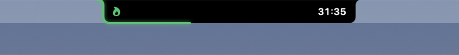
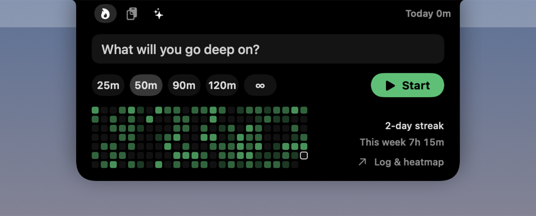
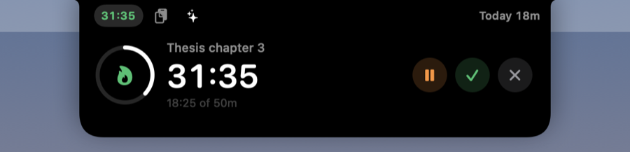
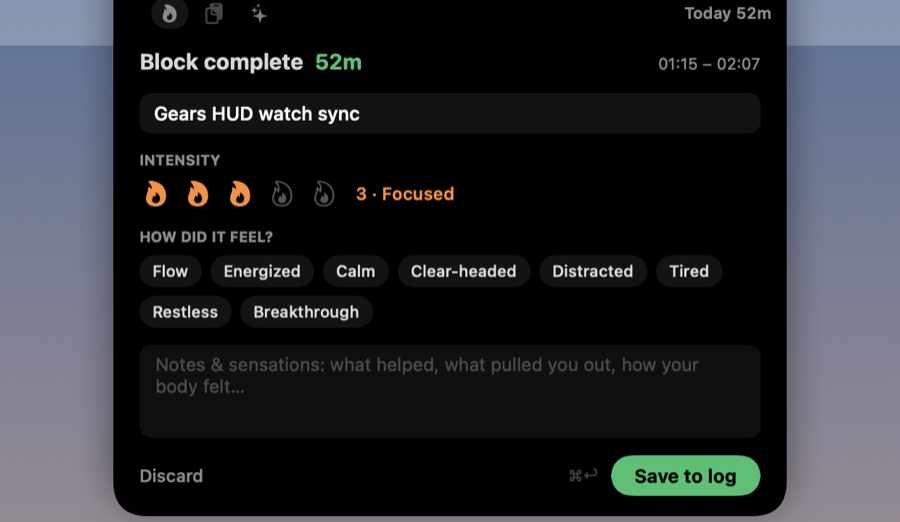
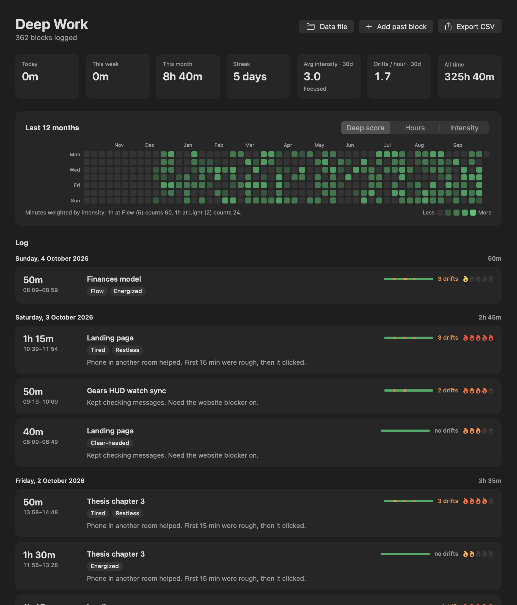
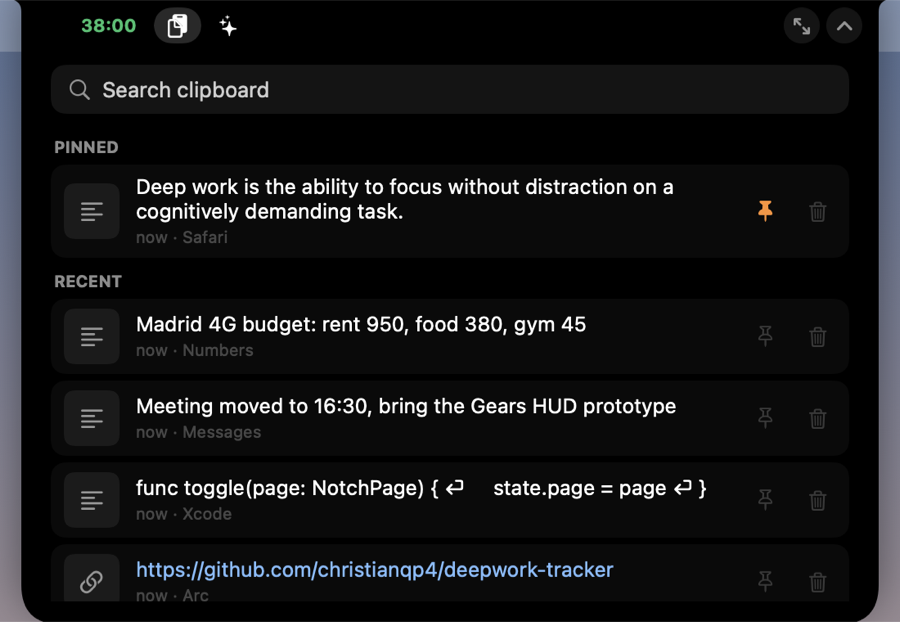
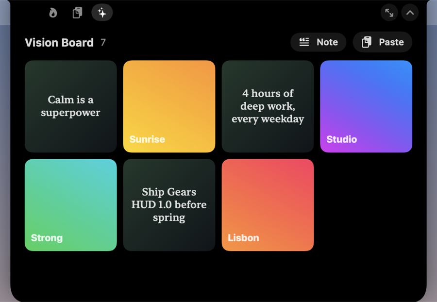
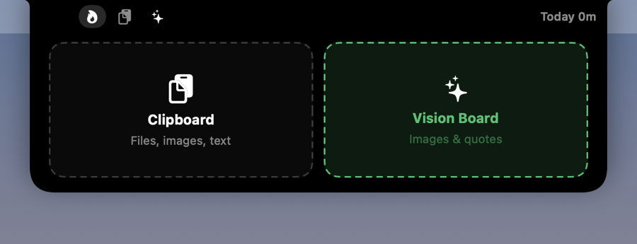

# DeepWork Tracker

A macOS notch app with three pages that swap in place:

- **Timer**: deep work blocks with a log of every block, intensity ratings, notes on how it felt, and a GitHub-style heatmap of the year
- **Clipboard**: history of everything you copy (text, images, files), with pins and search
- **Vision Board**: images and quotes you want in front of you





## What it does

- **Lives in the notch.** Hover the notch to expand it. Pick a block length (25 / 50 / 90 / 120 min, or ∞ open-ended), name what you're working on, start.
- **Progress traced along the notch.** While a block runs, a line draws itself along the notch outline: down the left side, across the bottom, up the right. Green while running, orange when paused, pulsing once you pass your goal (it chimes and keeps counting overtime, so it never breaks your flow). Open-ended blocks fill the outline once per hour. The countdown sits beside the notch; turn that off in the menu (*Show Time Beside Notch*) for outline only.
- **Mini heatmap in the notch.** The last 24 weeks, streak, and this week's total, right under the Start button.
- **Log every block.** When you finish, the notch asks for:
  - **Intensity** 1–5 (Shallow · Light · Focused · Deep · Flow)
  - **Sensations** as quick tags (Flow, Energized, Calm, Clear-headed, Distracted, Tired, Restless, Breakthrough)
  - **Notes**: what helped, what pulled you out, how your body felt
  
  `⌘↩` saves.
- **Heatmap + log window.** Menu bar icon → *Log & Heatmap* (or the link in the notch). Three heatmap modes:
  - **Deep score**: minutes × intensity / 5. An hour at Flow counts more than an hour at Light.
  - **Hours**: raw time.
  - **Intensity**: average intensity for the day.
  
  Click a day to filter the log. Click a block to edit it or delete it. Stats: today, week, month, streak, 30-day average intensity, all time.
- **Survives restarts.** A running block is saved, so quitting or rebooting doesn't lose it. The timer auto-pauses when the Mac sleeps.




## Pages, shortcuts and opening the notch

| | |
|---|---|
| **Hover** the notch | Peeks open; closes when you move away |
| **Click** inside it | Stays open until **Esc**, the ⌃ button, or a click elsewhere |
| **⌃⌥D** | Timer |
| **⌃⌥V** | Clipboard (search is focused: type, **↩** copies the top match) |
| **⌃⌥B** | Vision Board |
| ⤢ button | Bigger layout for Clipboard and Vision Board |

The small icons left of the notch switch pages; while a block runs, the timer icon shows the countdown.

## Clipboard



- Everything you copy is kept: text, links, images, files. The last 10 show at a glance; **Show all** opens the full history (500 items, 80 images).
- **Click** an item to copy it again. **Drag** it out to drop it into any app. Right-click: pin, open link, show in Finder, add to Vision Board, delete.
- **Pin** favourites so they stay at the top and never expire.
- **Search** everything, including file paths and the app it came from.
- **Drag anything onto the notch** → drop on *Clipboard*.
- **Password managers are skipped**: anything marked concealed or transient ([nspasteboard.org](http://nspasteboard.org) convention, used by 1Password, Bitwarden, KeePassXC…), and anything copied while a password manager is in front.
- Pause or clear the history from the menu bar icon. History is stored only on this Mac, unencrypted, in `~/Library/Application Support/DeepWorkTracker/Clipboard/`.

## Vision Board




Drag images (or image files) onto the notch and drop on *Vision Board*, add a note (a goal, a quote), or **Paste** what's on the clipboard. Click a tile to see it big.

## Build & install

Requires macOS 14+ and Swift 5.9+. Xcode's Command Line Tools are enough; you don't need full Xcode.

```bash
./scripts/build-app.sh            # builds build/DeepWork Tracker.app
./scripts/build-app.sh --install  # also copies it to /Applications and launches it
```

There's no Dock icon. Look for the 🧠 icon in the menu bar. *Launch at Login* is in that menu.

> If you run another notch app at the same time, they'll draw on top of each other. Quit the other one.

## Data

Everything is local, in one human-readable file:

```
~/Library/Application Support/DeepWorkTracker/sessions.json
```

```json
{
  "version": 1,
  "sessions": [
    {
      "id": "…", "start": "2026-10-03T09:12:00Z", "end": "2026-10-03T10:04:00Z",
      "duration": 3120, "plannedMinutes": 50, "task": "Thesis chapter 3",
      "intensity": 4, "tags": ["Flow", "Calm"], "notes": "Phone in another room helped."
    }
  ]
}
```

`duration` is in active seconds, excluding pauses. The format is deliberately simple so other clients (e.g. the Gears HUD watch app) can read and append to it. You can also export it as CSV from the dashboard.

## Development

```
Sources/DeepWorkTracker/
  AppDelegate.swift      menu bar item, dashboard window, app menu, shortcuts
  NotchController.swift  the floating panel over the notch: hover, pin, click-through, Esc
  NotchRoot.swift        page switching, top band tabs, drop targets
  ClipboardStore.swift   pasteboard watcher, history storage, drop parsing
  ClipboardPage.swift    clipboard UI
  VisionBoard.swift      vision board storage + UI
  HotKeys.swift          global shortcuts (Carbon, no permissions needed)
  NotchViews.swift       collapsed / idle / running / finish UI
  TimerEngine.swift      timer state machine (idle → running ⇄ paused → finishing)
  SessionStore.swift     JSON persistence + stats
  DashboardView.swift    stats, heatmap card, log, editor
  HeatmapView.swift      53-week grid
  Components.swift       shared pieces (notch shape, intensity picker, tags…)
  Snapshots.swift        renders UI states to PNG with sample data
```

Render every UI state to PNGs without touching your real data (useful for checking UI changes):

```bash
swift build -c release && DEEPWORK_SNAPSHOT=/tmp/dw-shots .build/release/DeepWorkTracker
```

Regenerate the app icon: `swift scripts/make-icon.swift && iconutil -c icns Resources/AppIcon.iconset -o Resources/AppIcon.icns`

## Roadmap

- [ ] Gears HUD (Wear OS) companion: start/stop from the watch, sync `sessions.json`
- [x] Global shortcuts (⌃⌥D / ⌃⌥V / ⌃⌥B)
- [ ] Customisable shortcuts
- [ ] Manual entry for blocks done away from the Mac
- [ ] Weekly review: intensity trends, best time of day, which tags go with high intensity
