# GNotch for Ubuntu (GNOME Shell extension)

GNotch in the Ubuntu top bar, with the same three pages as on the Mac: **timer**, **clipboard** and **vision board**. Ubuntu has no notch, so it sits **right after the clock** in the middle of the top bar, the closest spot to where the notch is on a Mac. While a block runs, its progress is traced around the indicator like the line around the notch. Prefer it with the system icons (wifi, sound, battery)? Turn off **Next to the clock** in the card.

Works on GNOME 42 to 49: **Ubuntu 22.04 LTS**, 23.04, 23.10, **24.04 LTS**, 24.10, 25.04, 25.10. GNOME 45 changed how extensions are loaded, so the zip holds two builds (`build/42` for GNOME 42–44, `build/45` for 45+) and `install.sh` picks the right one.

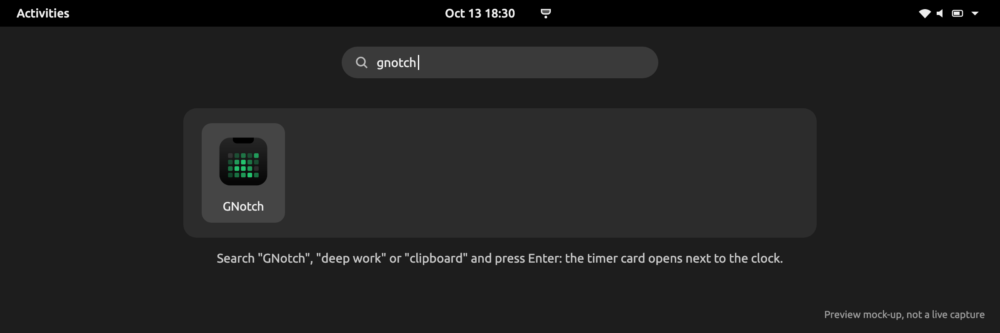
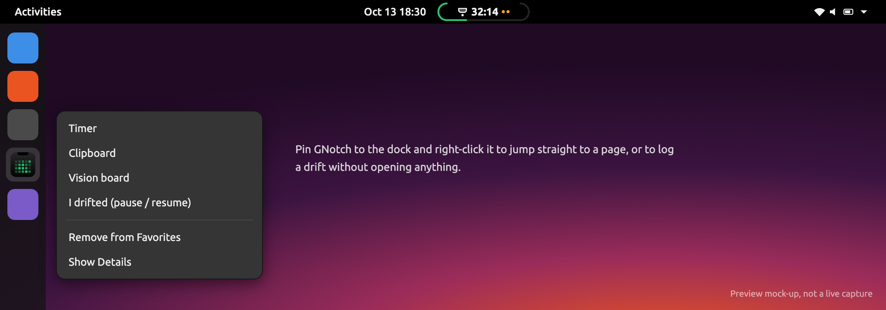
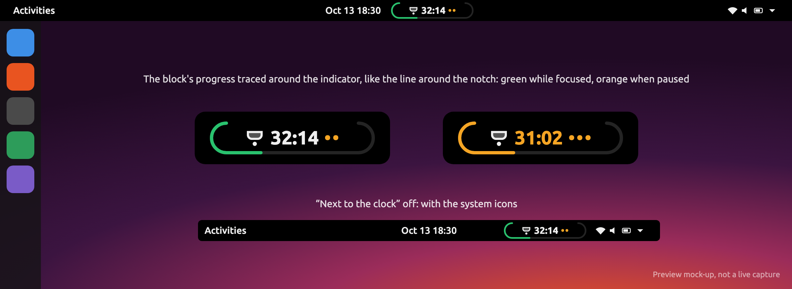
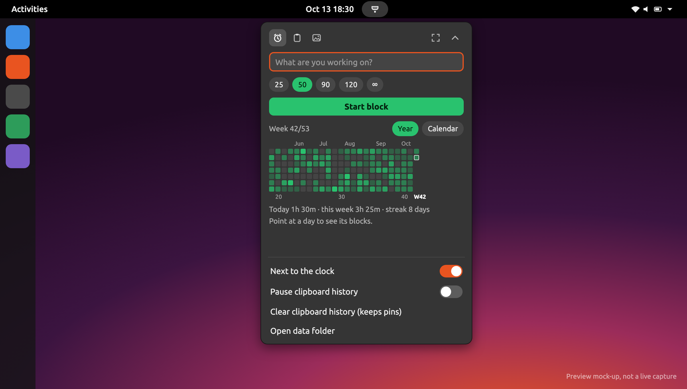
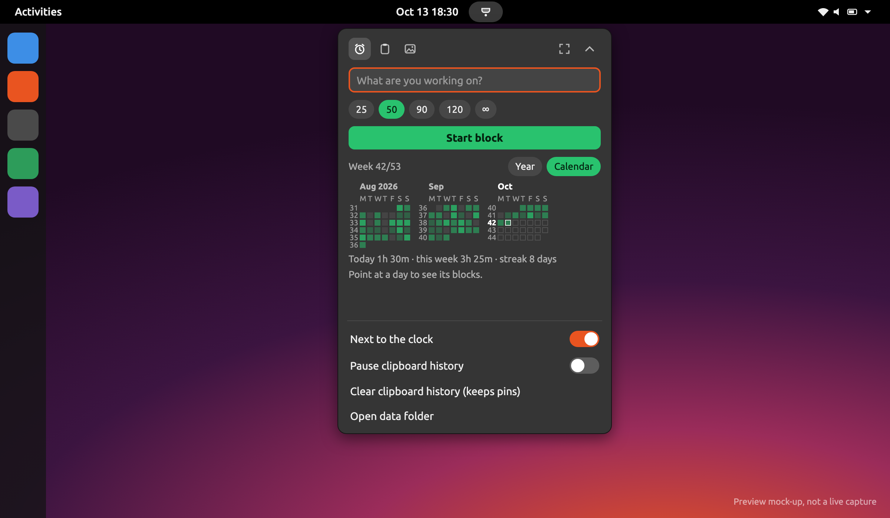
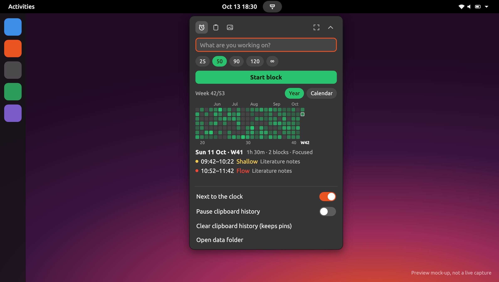
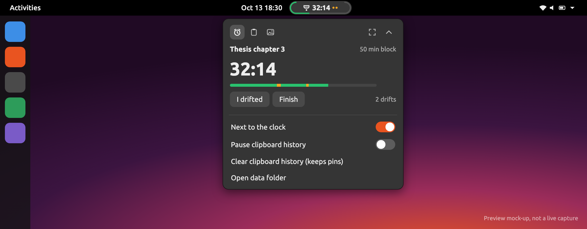
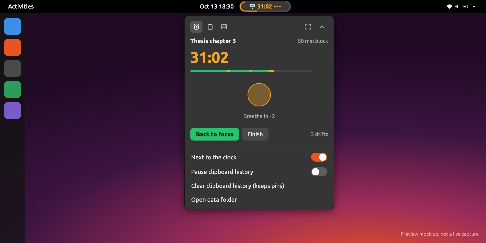
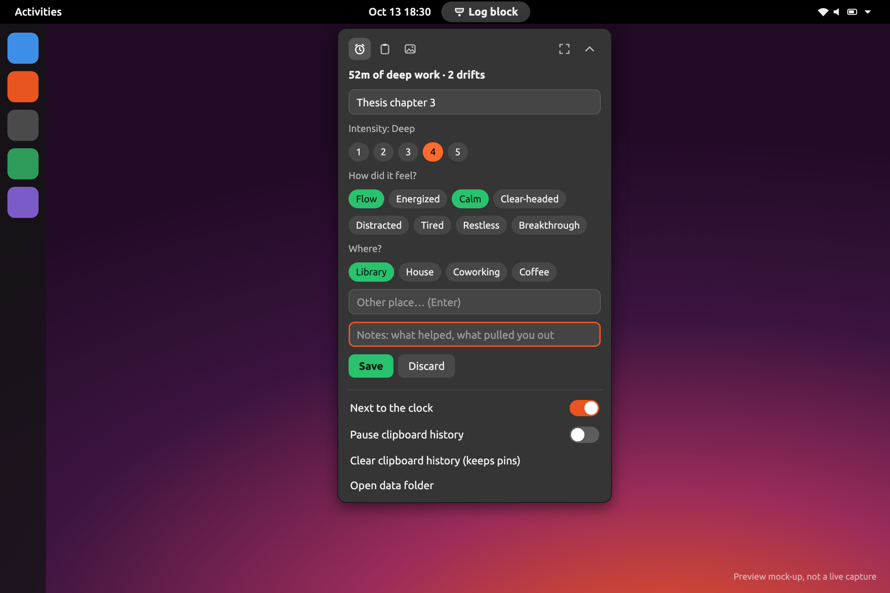
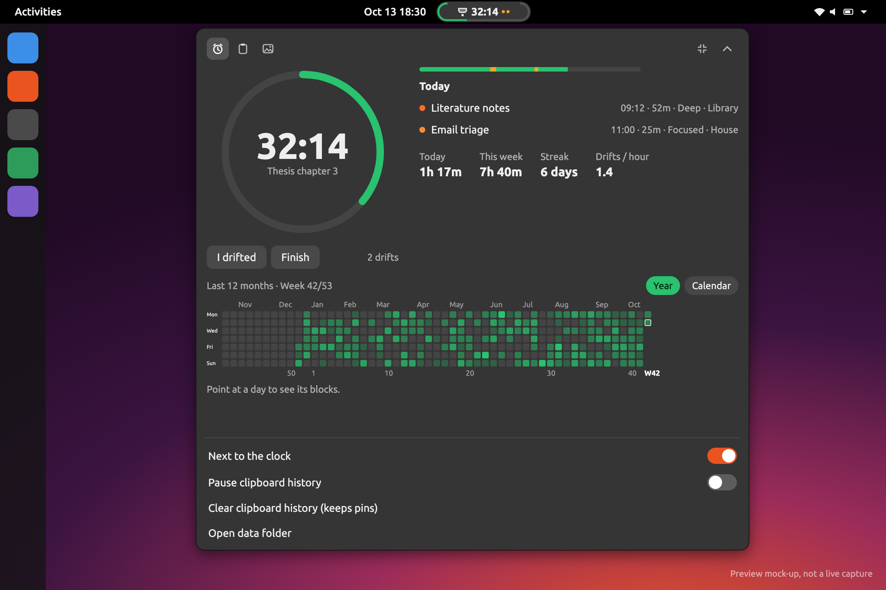
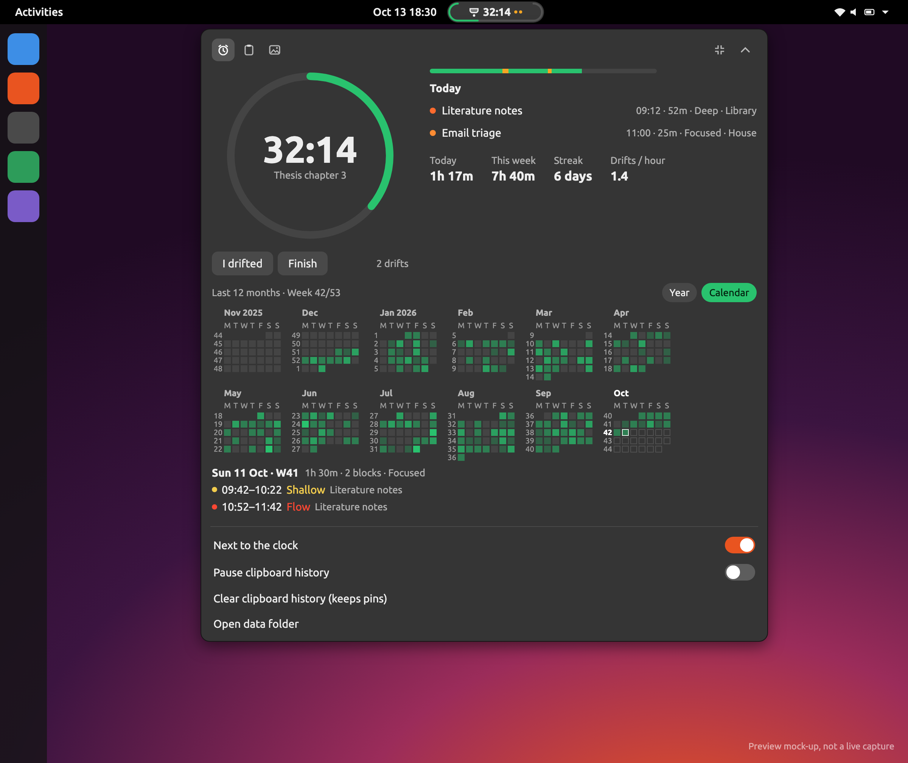
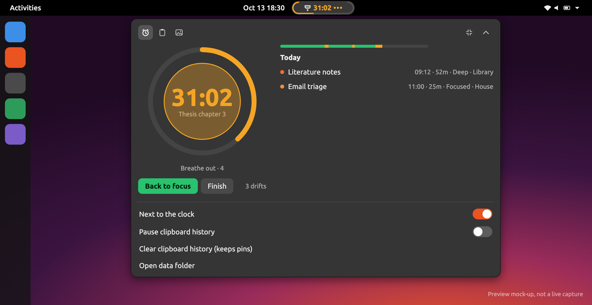
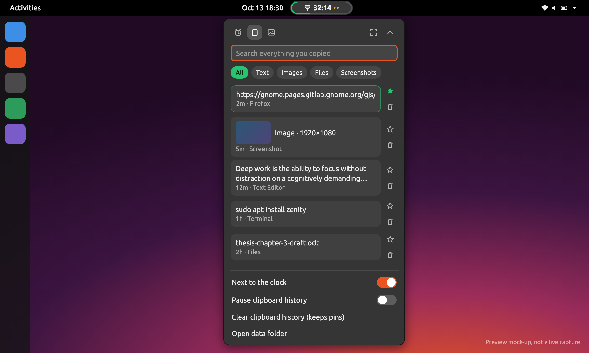
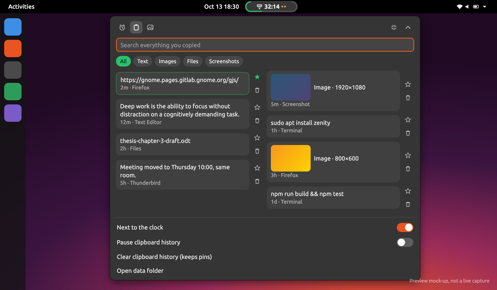
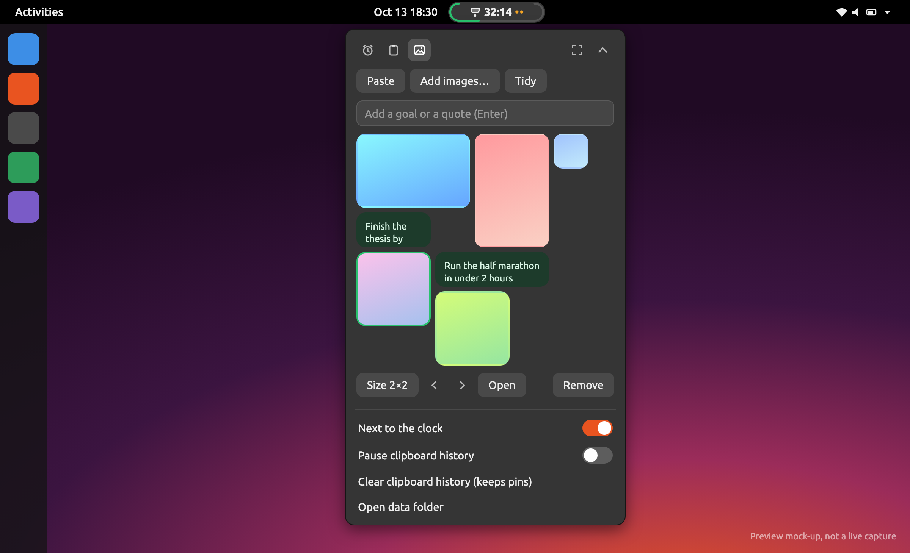
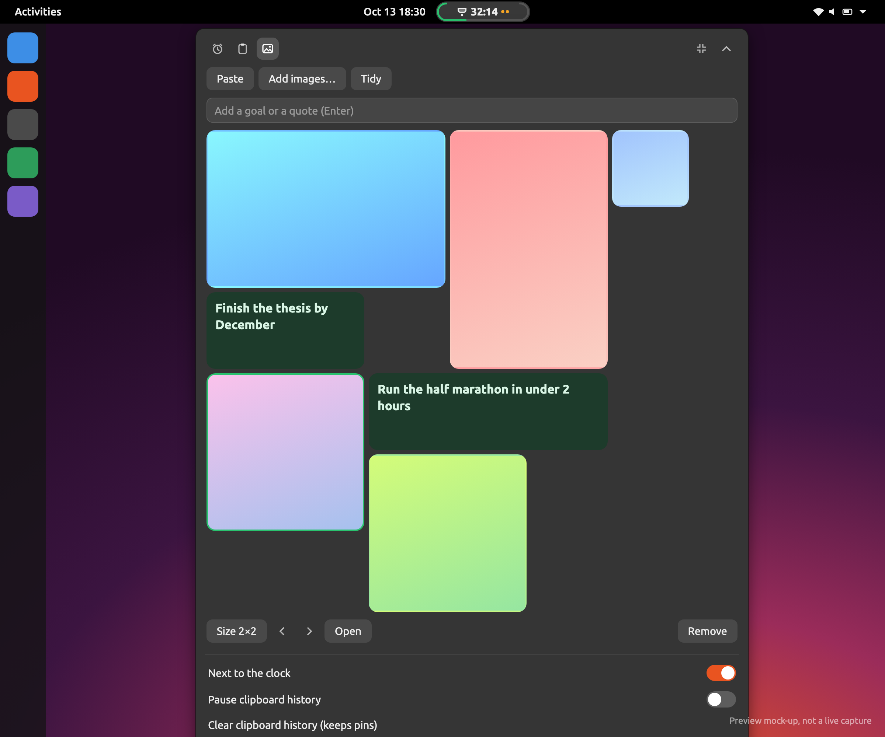

*These are mock-ups rendered from `preview/preview.html` (same texts, sizes and colors as the extension; the heatmaps come from the extension's own `core.js`), not live captures. Regenerate with `preview/shoot.sh`.*

## What's in it (v0.6.1)

| | |
|---|---|
| **GNotch** in Activities | Search "GNotch" (or "deep work", "clipboard"…) and press Enter: opens the timer. Pin it to the dock; right-click it for Timer, Clipboard, Vision board and *I drifted* |
| Click the indicator | Opens the card. **⤢** makes it big (or small again), **⌃** tucks it away, **Esc** too |
| **⌃⌥D** · **⌃⌥V** · **⌃⌥B** | Timer · Clipboard (search focused, **↩** copies the top match) · Vision board. Again to close |
| **⌃⌥P** | I drifted: pause and breathe (again to go back to focus) |

**Timer**
- **Blocks**: 25 / 50 / 90 / 120 min or ∞ open-ended, with a task name. Countdown in the top bar, `+overtime` after the goal (with a chime and a notification).
- **Progress around the indicator**: a "U" traced around the icon and countdown, like the line around the Mac notch: green while focused, orange when paused, pulsing past the goal. Open-ended blocks fill it once per hour.
- **Drift tracker**: *I drifted* pauses the block and logs a drift. The card turns into a breathing guide (the circle grows for 4 s, shrinks for 6 s, with a countdown) until you go back to focus. The drift bar shows focus in green and drifts in orange. Suspending the computer pauses too, but that isn't counted as a drift.
- **Finish form**: intensity 1–5, sensation tags, place (Library, House, Coworking, Coffee, or your own), notes.
- **Heatmap, two views** (*Year | Calendar*, remembered):
  - **Year**: GitHub-style, zoomed out to see the trend. Month names on top, week numbers underneath (1, 10, 20 … and this week, **W42**).
  - **Calendar**: months side by side, days left to right, every week numbered, days ahead outlined so you can plan.
  - **Week 42/53** in the header. **Point at a day** to see its date, total and each block's time and intensity.
- **Big mode**: progress ring with the time inside (the breathing circle grows inside it when paused), today's blocks, stats (today, week, streak, drifts per hour) and the last 12 months.
- **Survives restarts**: a running block is saved and picks up where it left off.

**Clipboard**
- Everything you copy: text, images, files (from Files). Search, filter (All · Text · Images · Files · Screenshots), pin ★ (pins never expire), delete. Click an item to put it back on the clipboard; the card closes so you can paste.
- **Screenshots** lists `~/Pictures/Screenshots` (where Print Screen saves). Ubuntu already copies every screenshot to the clipboard, so they also land in the history.
- **Password managers are skipped**: copies marked `x-kde-passwordManagerHint` (KeePassXC and others) and anything copied while a password manager window (KeePassXC, Bitwarden, 1Password, Secrets…) is focused. Pause or clear the history from the card's menu. Kept for 500 items / 80 images, unencrypted, in `~/.local/share/gnotch/Clipboard/`.

**Vision board**
- Images and goals as widgets on a 6-column grid that never overlaps. **Paste** an image or text from the clipboard, **Add images…** (file picker), or type a goal or quote.
- Click a widget to resize it (steps through sizes), move it earlier or later, open it or remove it. **Tidy** resets sizes, newest first.
- Same `board.json` as the Mac app: copy `~/Library/Application Support/GNotch/VisionBoard/` to `~/.local/share/gnotch/VisionBoard/` to bring your Mac board over (or back).

Not in the Ubuntu version yet: the dashboard/log window, adding past blocks and focus sounds.

## Install

1. Download `gnotch-gnome-<version>.zip` from the repo's **Releases** page (you need to be a collaborator on the private repo).
2. Unzip it and run the installer:
   ```bash
   unzip gnotch-gnome-*.zip -d gnotch && cd gnotch && ./install.sh
   ```
3. **Log out and back in** (on Wayland, GNOME only loads new extensions at login).
4. If the icon isn't in the top bar yet: `gnome-extensions enable gnotch@christianqp4.github.io`
5. Still nothing? `gnome-extensions info gnotch@christianqp4.github.io` shows its state (`ERROR` or `OUT OF DATE` say why).

The installer also adds **GNotch to your apps** (Activities search, app grid, dock). The launcher doesn't start a separate program: GNotch runs inside GNOME Shell, and the icon just opens its card.

Update: same steps with the new zip. Uninstall: `./install.sh --uninstall` (removes the extension and the launcher; your data stays in `~/.local/share/gnotch`).

From a clone instead of a zip: `./linux/gnome-extension/install.sh` (needs Node.js to build first).

## Data

```
~/.local/share/gnotch/sessions.json   the blocks (same format as the Mac app)
~/.local/share/gnotch/state.json      the running block, places, view settings
~/.local/share/gnotch/VisionBoard/    board.json + images (same format as the Mac app)
~/.local/share/gnotch/Clipboard/      history.json + images
```

`sessions.json` is the same file format as on the Mac (`~/Library/Application Support/GNotch/sessions.json`), so you can copy it between machines in either direction. Dates are written without milliseconds because the Mac app requires that. The extension re-reads the file before every save, so blocks another client added aren't lost, and a file it can't read is backed up instead of overwritten.

## Development

```
gnotch@christianqp4.github.io/
  extension.js   top bar indicator, the three pages, shortcuts, clipboard and sleep watchers
  core.js        timer, sessions.json format, stats, heatmap views, ISO weeks, clipboard and
                 vision board logic (no GNOME imports, tested with Node)
  store.js       files: sessions, state, vision board, clipboard history
  ui.js          St widgets: buttons, chips, progress outline and ring, heatmaps
  stylesheet.css
preview/         HTML mock-up + shoot.sh for the README images (docs/)
build.mjs        makes build/45 (a copy) and build/42 (converted to GNOME 42's old imports.* modules)
test/core.test.mjs
install.sh, package.sh
```

Write the source as GNOME 45+ ES modules only. Things that differ between GNOME versions and have bitten before:

- **Scroll views**: on GNOME 42–45 the content must be attached with `add_actor()`; `set_child()` leaves it unallocated and can hang the whole shell (it ended the session on 0.6.0). GNOME 46 removed `add_actor()`. `UI.scroll()` handles both.
- **Images**: St decodes CSS background images synchronously at full size, in the compositor. Always go through `Store.thumbnail()` (async, cached in `~/.cache/gnotch/thumbs`).
- **Rebuilding the card**: call `_render()`, which runs on idle, never from inside a click handler of a widget it destroys, and it moves keyboard focus off entries first.

 `build.mjs` converts it for GNOME 42–44, so keep the imports in the forms it knows (it fails loudly on anything else).

```bash
node --test linux/gnome-extension/test/core.test.mjs   # logic tests, run anywhere
linux/gnome-extension/package.sh                       # builds dist/gnotch-gnome-<version>.zip
```

To try changes on Ubuntu: `./install.sh`, then on Xorg press Alt+F2 and type `r`; on Wayland run a nested shell (`dbus-run-session -- gnome-shell --nested --wayland` on GNOME 45–48, `--devkit` on 49) or log out and in. Logs: `journalctl -f -o cat /usr/bin/gnome-shell`.

**Release**: bump `version-name` in metadata.json and push a tag like `gnome-v0.5.1`. The GitHub workflow runs the tests, builds the zip and attaches it to a release.
